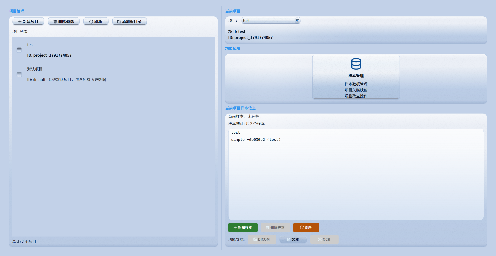
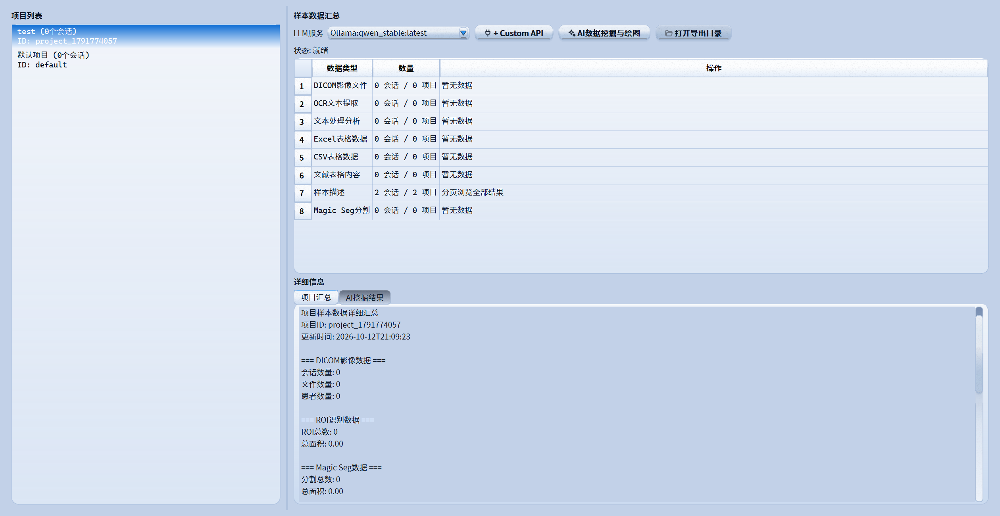
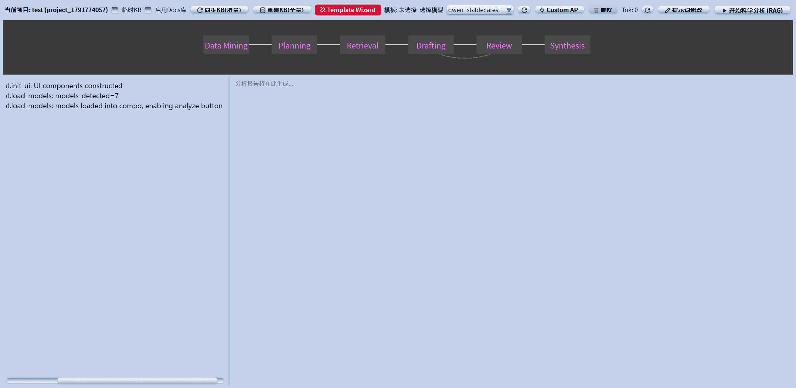
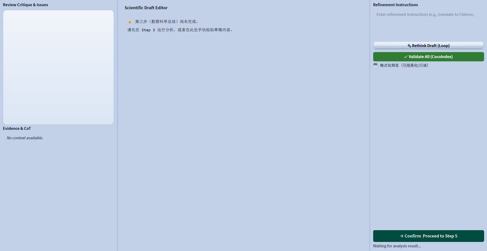
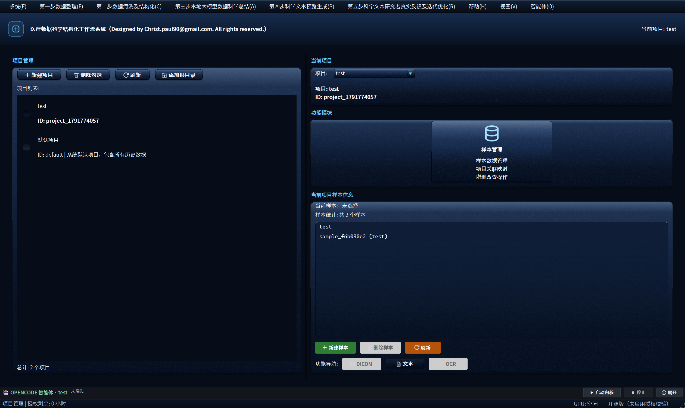

# 医疗数据科学结构化工作流系统 · Medical Imaging Workflow

> **Release V2.0** · 面向医学科研的 DICOM 影像处理 / 数据清洗 / 大模型总结 / 科学文本生成一体化工作流
> Designed by **Christ (hg3992260@gmail.com / hg3992260@qq.com)**

<p align="center">
  
</p>

<p align="center">
  
  
  
  
  
  
</p>

---

## 目录

- [一、项目简介](#一项目简介)
- [二、V2.0 新特性](#二v20-新特性)
- [三、界面截图](#三界面截图)
- [四、五大工作流](#四五大工作流)
- [五、目录结构](#五目录结构)
- [六、环境要求](#六环境要求)
- [七、安装](#七安装)
- [八、模型与外部资源（不随仓库分发）](#八模型与外部资源不随仓库分发)
- [九、内嵌 opencode 智能体（V2.0）](#九内嵌-opencode-智能体v20)
- [十、大模型后端配置：Ollama / 自定义 API](#十大模型后端配置ollama--自定义-api)
- [十一、运行](#十一运行)
- [十二、打包与发布](#十二打包与发布)
- [十三、更新日志](#十三更新日志)
- [十四、关于 / About](#十四关于--about)
- [十五、免责声明](#十五免责声明)

---

## 一、项目简介

本系统把「医学科研数据 → 可发表科学文本」的全过程沉淀为一条 **5 步式可视化工作流**：

1. **数据整理**：项目管理、DICOM 影像 ROI 交互式分割（SAM）、OCR 识别、文本处理、样本管理；
2. **数据清洗及结构化**：表格/文献/影像数据的自动清洗、结构化与汇总（LLM 引导的 sklearn 数据挖掘与绘图）；
3. **本地大模型数据科学总结**：调用 **本地 Ollama** / **任意 OpenAI 兼容 API** / **内嵌 openCode 智能体**，把结构化数据转为科学结论与图表；
4. **科学文本预览生成**：初稿落成 **图文 Word（.docx）**，交互反馈以 **Word 批注**记录并同步正文；
5. **研究者真实反馈与迭代优化**：审阅—修订—再审阅的闭环仪表盘，支持 **一稿一 docx 批量导出**。

> **本仓库为「纯源码 + 依赖清单」发行版：不含任何模型权重、CUDA 库、Ollama 二进制或安装包。**
> 这些重资源体积达数十 GB，请按 [第八节](#八模型与外部资源不随仓库分发) 单独获取。
> 大模型推理后端可在界面上自由选择 **本地 Ollama** / **外部 API** / **内嵌 openCode**。

---

## 二、V2.0 新特性

| # | 特性 | 说明 |
|---|------|------|
| 1 | **内嵌 openCode 智能体** | 一键启动内嵌 openCode 内核（隔离 home）；**独立终端窗口（TUI shell）随程序自动打开**并跟随当前项目会话；`loopx` 为默认 agent；23+ 个 `medwork` MCP 工具把宿主领域能力暴露给智能体 |
| 2 | **推理网关（共享上下文）** | 全应用推理统一路由到内嵌 openCode 的项目会话——Step2 挖掘计划、Step3 写作、Step4 交互反馈**共享同一上下文**；兼容旧 `llm_service` 契约，`MIMW_INFER_BACKEND=legacy` 可回退 |
| 3 | **写作引擎委托化** | 原程序内自建 skill loop（多阶段编排）默认移出运行路径，整篇论文写作/评审/精修委托给内嵌 openCode（`MIMW_DRAFT_ENGINE=legacy` 可回退） |
| 4 | **Step4 = 图文 Word** | 初稿经 **officeCLI** 落成图文 `.docx`（标题/各节/图片/参考文献）；每轮交互（Rethink / 局部重写 / CGR 精修）记录为 **Word 批注**并 **`set /body/p[n]` 同步正文** |
| 5 | **Step5 批量导出** | 「导出 Word」（含批注的最新稿）+「批量导出草稿」（**一稿一 docx**，空稿跳过，python-docx 兜底） |
| 6 | **双主题皮肤引擎** | 浅色 = **液态玻璃（Liquid Glass）**；深色 = **鎏金**（深蓝金属底 + 金色强调）；QProxyStyle 三维绘制（按钮/井/面板/滚动条…），热切换 |
| 7 | **矢量图标系统** | 52+ 内联 SVG 图标、主题感知、热刷新，零外部资源（PyInstaller 免收集 assets） |
| 8 | **PyQt5 → PyQt6 兼容层** | `src/core/qt_compat` 单点适配，同一套源码兼容 PyQt5 / PyQt6（6.10.2 实测） |
| 9 | **首次运行初始化面板** | 模型权重逐项检查/下载（HTTP 直连 HuggingFace）+ 推理后端（Ollama / 外部 API）配置 |
| 10 | **稳定性修复** | pythonw 无控制台下 MCP/uvicorn 启动崩溃修复；内核 1.x/2.x 共存时的二进制优选；进程树精确回收（不误伤用户 openCode 进程） |

---

## 三、界面截图

### 3.1 五大工作流页面（V2.0 · 液态玻璃浅色主题）

| 第一步 · 数据整理 | 第二步 · 数据清洗及结构化 |
|---|---|
|  |  |

| 第三步 · 数据科学总结 | 第四步 · 科学文本预览 |
|---|---|
|  |  |

### 3.2 鎏金深色主题（V2.0）



### 3.3 内嵌 openCode 智能体栏与 MCP 工具


### 3.4 更多截图

- 大模型总结：`docs/screenshots/04_llm_summary.png`
- 数据清洗：`docs/screenshots/05_data_cleaning.png`
- 科学文本预览：`docs/screenshots/06_text_preview.png`
- 迭代优化：`docs/screenshots/07_feedback.png`
- 首次运行初始化：`docs/screenshots/08_first_run_setup.png`
- 关于对话框：`docs/screenshots/02_about.png`

---

## 四、五大工作流

| 步骤 | 菜单 | 说明 |
|------|------|------|
| 第一步 | 数据整理 | 项目管理、DICOM ROI 识别（SAM）、文本处理、OCR 识别、Magic Seg、样本管理 |
| 第二步 | 数据清洗及结构化 | 表格/文献结构化、数据汇总、**LLM 引导的数据挖掘与绘图**（计划/图注经推理网关） |
| 第三步 | 本地大模型数据科学总结 | **写作引擎委托内嵌 openCode**（原 core loop 可切换）、前置挖掘、评审—精修闭环 |
| 第四步 | 科学文本预览生成 | **图文 Word（officeCLI）**、交互=**批注**、正文同步 |
| 第五步 | 研究者真实反馈及迭代优化 | 反馈仪表盘、**Word 导出（单份/批量一稿一 docx）**、反 AIGC / 语法 / 去重技能链 |

---

## 五、目录结构

```
medical_imaging_workflow/
├── main.py                     # 程序入口（环境引导 / 皮肤 / 许可 / 内嵌 openCode 自启动）
├── requirements.txt            # 依赖清单（仅代码依赖）
├── MedicalImagingWorkflow.spec      # 完整版 PyInstaller spec
├── MedicalImagingWorkflow_Lite.spec # Lite 版 spec（不含重资源）
├── config/
│   ├── app_config.json         # 应用配置（名称/版本/主题/数据库…）
│   └── model_paths.json        # 外部模型路径映射
├── src/
│   ├── ai/                     # 写作管线（委托引擎）、Agent 技能链、评审、逻辑链
│   │   ├── opencode_delegation.py   # ★ 委托式写作引擎（V2.0）
│   │   ├── agent_skills/       # 反AIGC / 语法 / 去重 / 片段手术 / PPT 生成…
│   │   └── tools/              # Python 代码执行工具等
│   ├── kernel/                 # ★ 内嵌 openCode（V2.0）
│   │   ├── kernel_boot.py      #   总控：起 MCP → 内核 → TUI 控制台 → 绑会话
│   │   ├── kernel_client.py    #   进程托管 / legacy V1 HTTP / TUI / 问答回灌
│   │   ├── kernel_driver.py    #   run_turn / 事件归一化
│   │   ├── inference_gateway.py#   推理网关（共享上下文）
│   │   ├── mcp_server.py       #   FastMCP/MCPServer 双 SDK 适配
│   │   ├── tools/              #   medwork 领域工具（项目/存储/清洗/聚合/挖掘/Word/LLM/界面）
│   │   └── kernel_assets/      #   随包 agent（loopx / medical-workflow）与 skill
│   ├── core/                   # 配置、常量、事件总线、路径、qt_compat（PyQt5/6 兼容层）
│   ├── services/               # 业务服务（DICOM/OCR/清洗/LLM/数据库/文献/Word…）
│   │   └── step4_word_service.py    # ★ Step4 图文 Word + 批注 + 正文同步（officeCLI）
│   ├── models/                 # 数据模型
│   ├── utils/                  # 皮肤引擎（skeuomorphic / skeuo_style）、图标、主题、日志
│   ├── adapters/               # DeepSeek-OCR 适配器
│   └── cocoindex_compat/       # 兼容层（cocoindex 缺失时的降级实现）
├── ui/
│   ├── widgets/                # 主窗口 + 五步页面 + opencode 面板 + 对话框
│   └── dialogs/                # 首次运行初始化等对话框
├── license_manage/             # 授权管理（源码模式默认开放运行）
├── scripts/                    # 自检 / 回归测试脚本（含内嵌 openCode 全套自检）
├── docs/                       # 设计文档与截图（皮肤/图标/内嵌 openCode/推理审计）
└── assets/                     # 仅图标（icon.ico / medlogo.png）
```

---

## 六、环境要求

- **操作系统**：Windows 10 / 11（macOS / Linux 未完整验证）
- **Python**：3.10 或 3.11
- **GUI**：PyQt5 或 **PyQt6**（同一套源码经 `src/core/qt_compat` 自动适配）
- **Node.js**（可选，用于内嵌 openCode）：≥ 18，`npm i -g opencode-ai`（1.x）
- **硬件**：建议 NVIDIA GPU（≥ 8GB 显存）以运行本地大模型；纯 CPU 亦可运行 UI 与数据处理
- **内存**：≥ 16GB 建议

## 七、安装

```bash
git clone https://github.com/yinianyuntech/medical_imaging_workflow.git
cd medical_imaging_workflow

python -m venv .venv
.venv\Scripts\activate        # Windows

# 1) 如需 GPU：先安装带 CUDA 的 PyTorch（示例，按官网选择版本）
pip install torch torchvision --index-url https://download.pytorch.org/whl/cu121

# 2) 安装其余依赖（含 PyQt6 / mcp SDK 等）
pip install -r requirements.txt

# 3) 运行
python main.py
```

> 源码/开发模式默认 **不强制授权激活**（`RSNA_LICENSE_ENFORCE=0`）。
> 如需强制校验：`set RSNA_LICENSE_ENFORCE=1`。

## 八、模型与外部资源（不随仓库分发）

以下资源需单独获取并放到指定目录（路径可在 `config/model_paths.json` 与界面中调整）：

| 资源 | 用途 | 建议放置路径 | 获取方式 |
|------|------|--------------|----------|
| Ollama 运行时 | 本地大模型推理 | 系统安装即可 | https://ollama.com/download |
| Ollama 模型 | 总结/抽取 | Ollama 默认模型目录 | `ollama pull qwen2.5:7b` 等 |
| DeepSeek-OCR 权重 | OCR 识别 | `assets/models/deepseek_ocr` | HuggingFace `deepseek-ai/DeepSeek-OCR` |
| SAM 权重 | 交互式分割 | `models/sam/sam_vit_b_01ec64.pth` | https://dl.fbaipublicfiles.com/segment_anything/ |
| Sentence-Transformers | 检索/嵌入 | `models/embedding/all-MiniLM-L6-v2` | HuggingFace `sentence-transformers/all-MiniLM-L6-v2` |
| Poppler（PDF→图片） | pdf2image | 加入 PATH | https://github.com/oschwartz10612/poppler-windows |
| **officeCLI**（可选） | Step4 图文 Word/批注 | `npm i -g @officecli/officecli` | https://www.npmjs.com/ |

**可选 Python 包**（未列入 requirements，按需安装）：
```bash
pip install git+https://github.com/facebookresearch/segment-anything.git   # SAM
```

环境变量（可选）：
```bat
set RSNA_DEEPSEEK_OCR_DIR=D:\models\deepseek_ocr
set RSNA_DEEPSEEK_OCR_SOURCE_DIR=D:\DeepSeek-OCR-main
set OLLAMA_HOST=http://localhost:11434
```

## 九、内嵌 openCode 智能体（V2.0）

系统内嵌 **openCode**（`opencode serve` + 宿主 MCP 工具面），把「医学科研工作流」交给真正的 agent 自主编排：

- **随程序自动启动**：打开程序即启动内嵌内核，并**同步打开独立终端窗口（TUI 控制台）**，
  跟随当前项目会话（项目切换自动跟随；面板「终端」按钮可随时重开/聚焦）；
- **共享上下文**：全应用推理（挖掘计划、图注、写作、Step4 批注反馈…）统一经**推理网关**
  路由到内嵌 openCode 的项目会话，前序步骤的结论与工具调用对后续推理可见；
- **宿主 = MCP 工具服务**：`medwork_*` 工具（项目/样本/存储/清洗/聚合/挖掘/Word 导出/界面导航…）
  让智能体用真实数据工作，而非凭空生成；
- **默认 agent = `loopx`**（随包定义，可 `MIMW_KERNEL_AGENT` 覆盖）；
- **闭环产出**：Step4 交互记录为 Word 批注并同步正文，Step5 支持批量导出。

```bat
:: 相关开关（可选）
set MIMW_KERNEL_AUTOSTART=1    :: 1=随程序启动内核+TUI（默认）；0=手动点「启动内核」
set MIMW_TUI_VISIBLE=1         :: 1=显示独立 TUI 窗口（默认）；0=隐藏
set MIMW_INFER_BACKEND=opencode:: opencode=推理走内嵌智能体（默认）；legacy=旧直连
set MIMW_DRAFT_ENGINE=opencode :: opencode=写作委托内嵌智能体（默认）；legacy=旧 core loop
set MIMW_KERNEL_MODEL=deepseek/deepseek-flash   :: 内核模型
set MIMW_KERNEL_AGENT=loopx    :: 默认 agent
```

自检脚本（见 `scripts/`）：
```bash
python scripts/test_kernel_embed.py --offline   # 内嵌内核静态自检
python scripts/test_kernel_embed.py             # 全链路（MCP+内核+会话+默认 agent）
python scripts/test_tui_console.py              # 独立 TUI 控制台（弹出/跟随/重开）
python scripts/test_inference_gateway.py        # 推理网关（共享上下文）
python scripts/test_opencode_delegation.py      # 委托式写作
python scripts/test_step4_word.py               # 图文 Word + 批注
python scripts/test_step45_sync_export.py       # 正文同步 + 批量导出
```

## 十、大模型后端配置：Ollama / 自定义 API

程序在启动时会自动探测 **内置 Ollama**；**若不存在内置运行时，则回退到系统 Ollama 或外部 API**，不会强杀用户已有的 Ollama 进程。

界面提供多种后端：

1. **本地 Ollama**
   - 安装 Ollama 并 `ollama pull <model>`；
   - 界面「LLM服务」下拉框会自动列出本机模型，直接选择即可。
2. **自定义 API 服务（OpenAI 兼容）**
   - 点击 **`+ Custom API`**，填写名称 / base_url（如 `https://api.deepseek.com`）/ api_key / 模型名；
   - 配置保存在 `config/custom_api_profiles.json`（已被 `.gitignore` 忽略，不会入库）。
3. **内嵌 openCode（推荐）**
   - 默认选项；无需单独配置，密钥由 `python -m src.kernel.kernel_cli import-key` 或首次运行面板导入。

## 十一、运行

```bash
python main.py
```

- **首次运行**会自动弹出 **「首次运行初始化 · 环境配置」** 面板：
  - **① 模型权重**：逐项显示 DeepSeek-OCR / 文本嵌入 / SAM 的**是否就绪**与体积，支持**单项下载**或**一键下载缺失项**；
  - **② 推理后端**：检测本地 **Ollama** 运行状态与模型列表；填写并**保存/测试**外部 **OpenAI 兼容 API**。
  - 可点「稍后」跳过；之后随时通过菜单 **帮助 → 环境初始化** 重新打开。
- **内嵌 openCode 随程序启动**：底部「OPENCODE 智能体」状态栏 + 独立 TUI 控制台窗口（见第九节）；
- 首次启动会在 `database/` 生成 SQLite 数据库；日志输出到 `logs/` 与 `startup.log`；
- 首次使用时请先「新建项目 / 添加根目录」导入数据。

## 十二、打包与发布

仓库提供两份 PyInstaller spec：

```bash
pip install pyinstaller

# 完整版（不含模型权重；内核二进制可选收集，opencode/ 目录存在时自动包含）
pyinstaller --clean MedicalImagingWorkflow.spec

# Lite 版（更小，首启面板按需下载模型）
pyinstaller --clean MedicalImagingWorkflow_Lite.spec
```

说明：
- `MIMW_SKIP_KERNEL=1` 可在打包时排除内嵌 openCode 二进制（运行时走系统安装的 openCode）；
- macOS `.dmg` 需要在 macOS 上构建（PyInstaller 不支持跨平台交叉编译）；
- 发布产物见 [Releases](https://github.com/yinianyuntech/medical_imaging_workflow/releases)。

## 十三、更新日志

### V2.0（当前）
- **内嵌 openCode 智能体**：内核自启动 + 独立 TUI 控制台 + 推理网关（共享上下文）+ 委托式写作引擎；
- **Step4 图文 Word 工作流**：officeCLI 落稿、交互=Word 批注、正文 `set /body/p[n]` 同步；
- **Step5 导出**：最新稿（含批注）导出 + 一稿一 docx 批量导出；
- **双主题皮肤**：液态玻璃（浅色）/ 鎏金（深色），QProxyStyle 三维绘制引擎；
- **矢量图标系统**：52+ 主题感知 SVG 图标，热切换；
- **PyQt5 → PyQt6 兼容**（`qt_compat`），6.10.2 实测；
- 首次运行初始化面板；pythonw 无控制台兼容修复；内核进程精确回收。

### V1.0
- 五步式工作流首版：数据整理 / 数据清洗及结构化 / 大模型总结 / 科学文本预览 / 迭代优化；
- Ollama 与 OpenAI 兼容 API 双后端；DICOM ROI（SAM）/ OCR / 模板化论文草稿。

## 十四、关于 / About

程序内「帮助 → 关于」对话框展示版本、作者、核心功能与项目主页。

- 版本 / Version：**2.0.0 (Release V2.0)**
- 作者 / Author：**Medical Imaging Team (hg3992260)**
- 项目主页：https://github.com/yinianyuntech/medical_imaging_workflow

## 十五、免责声明

本软件仅供 **科研与教学** 使用，**不得用于临床诊断或任何医疗决策**。
使用本软件产生的一切后果由使用者自行承担。模型输出可能包含错误，请务必人工核验。

---

<p align="center">© 2026 Medical Imaging Workflow · Released under the MIT License.</p>
